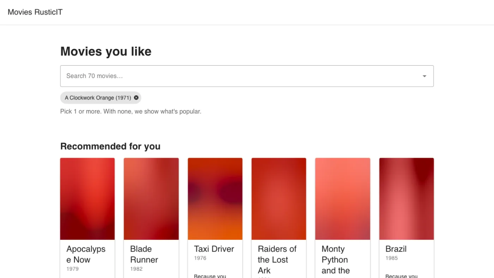
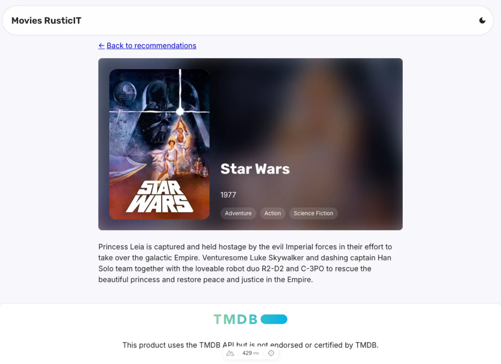
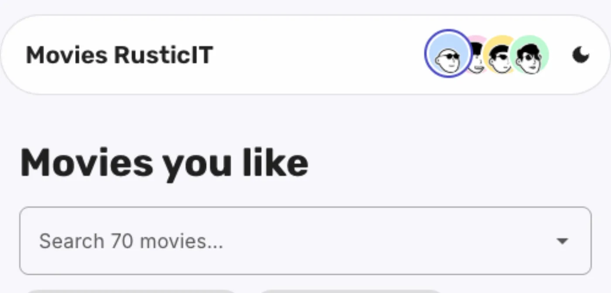
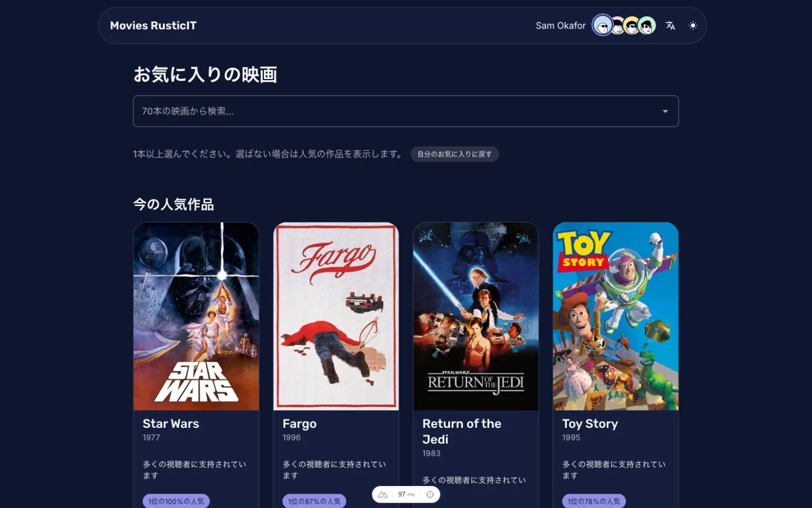
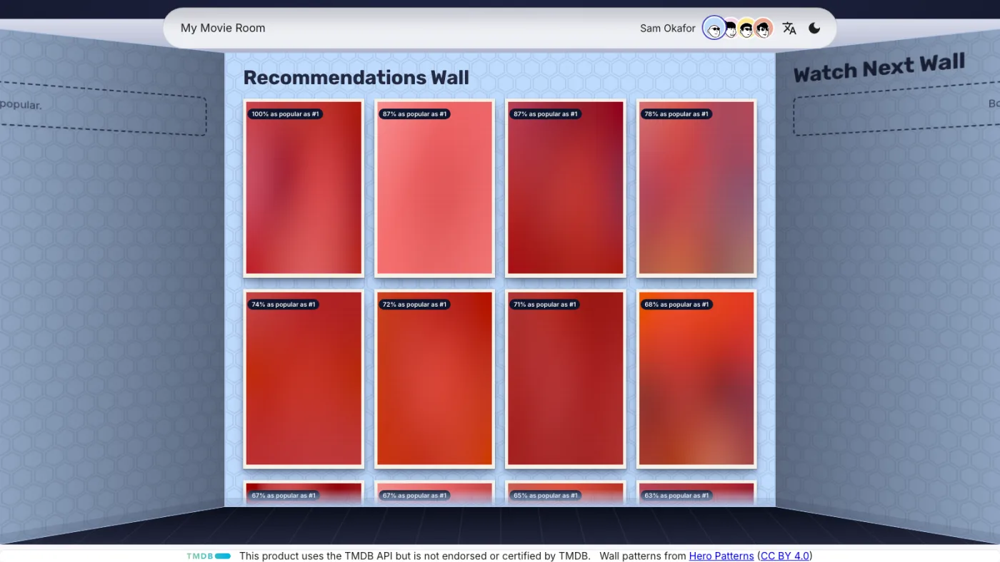
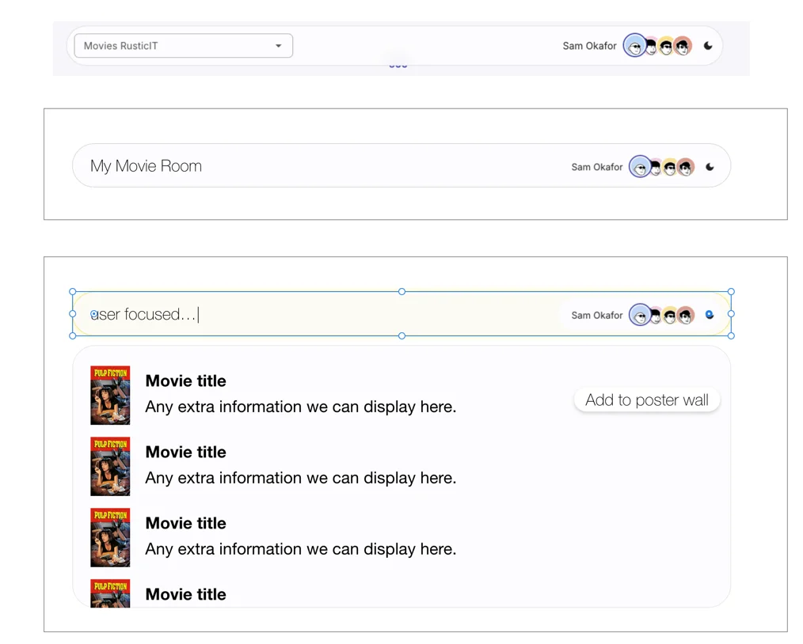
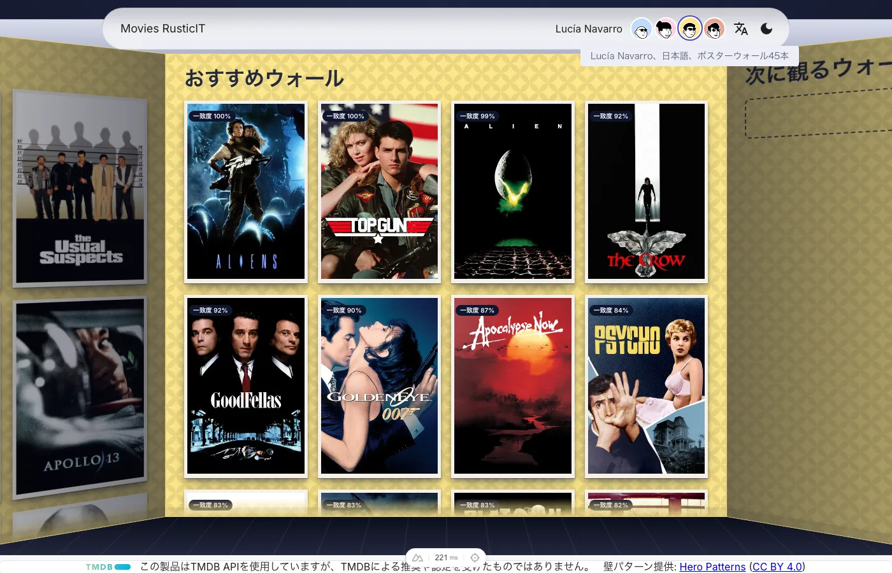
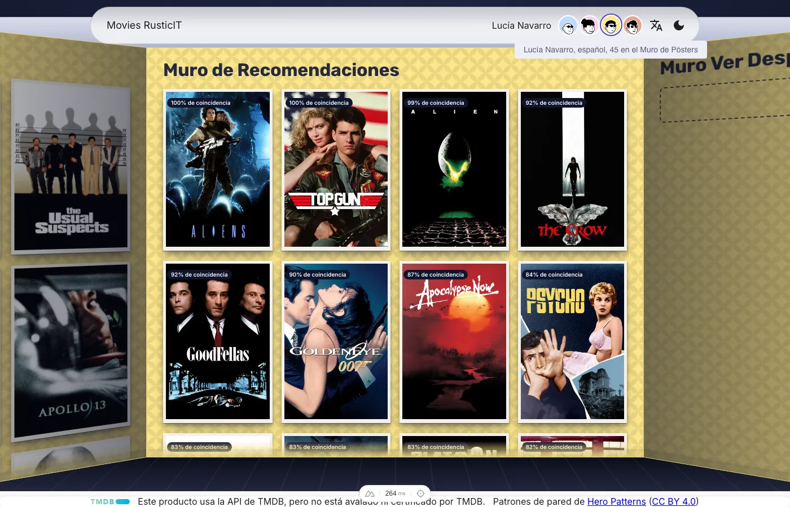

The brief fit in four lines.

A file with 70 movies. About 800 users and the movies each of them liked. Build something that works like Amazon's "people who liked these also liked": the visitor picks a few titles, the app recommends others from what the rest of the users did. Plan it first, find a free source for the movie data, follow Vue and Nuxt best practices, and test every component and endpoint end to end.

I started on Friday at 11 p.m. By Saturday afternoon I had a working recommender, a themed UI, a movie page with a shared-element transition, four user profiles, analytics, and a deploy config. The part that made it feel like mine took until Monday lunch, and the part that makes it safe to keep changing took until Monday afternoon.

The code is [public](https://github.com/sauloco/truefirestudios-movies-challenge). This post is about the decisions, in the order they happened, and about who made each one.

## Friday night: plan first, and review the plan like code

I didn't open an editor. I asked for a plan and reviewed it as an annotated HTML page, marking up the parts I disagreed with and sending them back.

A few decisions came out of that review and never moved again:

- **Nuxt 4 and Vue**, because that is the stack closest to the client's. A PoC should be judged on the idea, not on whether the team can read it.
- **TMDB for movie data**, with the API key used only by a build script. The resulting catalog is committed, so the running app never calls the API and the tests never touch the network.
- **Blurhash for every poster.** I asked for it before any UI existed, so the first screen that rendered already had a placeholder for each image.
- **End-to-end tests only.** Nuxt test utils plus Playwright, a real server and a real browser. No unit tests for now.
- **The dataset moves out of `public/`.** It started there, which means every user's like history would have been downloadable. It went to `server/assets/`, and a line in the project docs says user histories must never come back through the API.

**A plan you can annotate is cheaper to fix than code you have to unwrite.**

## How the recommender picks movies

A confession first: I didn't design this algorithm.

Recommendation systems are not my field. I could have spent the weekend learning enough to write one, and I would have ended up with a weaker recommender and a weaker front end. I chose to put my hours where I add the most value, which is the interface, and to hand the algorithm to the agent. I gave it the problem and the constraints, it proposed an approach in the plan, and I reviewed that plan the way I'd review a colleague's proposal in a field I don't know: asking why, asking how we'd know it works, and refusing to accept "trust me."

That second part is what made the delegation safe. I can't judge the math, but I can judge evidence.

What the agent proposed is item-based collaborative filtering on binary likes. No machine learning library, one file of about 120 lines, comments included.

Once, when the server first needs it, it builds two things from the 806 users: how many users liked each movie, and for each pair of movies how many users liked both. Then for a visitor with picks:

1. For each picked movie, look at every other movie that was liked together with it.
2. Skip movies the visitor already picked.
3. Skip pairs liked together by fewer than 3 users. That is noise, not taste.
4. Score the pair with a similarity that is damped by popularity.
5. Add up each candidate's similarity across all the visitor's picks.
6. Divide by the best score, so the top result is 1.0. The UI shows that as the match percentage.

The similarity is where the engineering is:

```
sim(pick → candidate) = coLikes / (likes(pick)^(1−α) × likes(candidate)^α)
```

At α = 0.5 that is plain cosine similarity. Raise α and popular movies get penalized, so a blockbuster has to be really connected to your picks to show up.

Nobody guessed α. The plan required a leave-one-out evaluation script, so the choice would rest on a number and not on anyone's confidence, mine included. For each of the 684 users with at least 5 likes, hide one liked movie, recommend from the rest, and check whether the hidden one lands in the top five.

| Approach | hit@5 |
| --- | --- |
| Most popular movies | 0.487 |
| α = 0.50 (cosine) | 0.545 |
| α = 0.60 | 0.504 |
| α = 0.80 | 0.406 |

The best number was α = 0.50, and the shipped value is 0.60. At 0.50 the metric looks great because it hands everyone the same blockbusters, and a metric that rewards that is measuring the wrong thing. 0.60 is the most accurate value that still beats the baseline while keeping results personal. I didn't need to derive that to understand it, and the comment above the constant says it plainly, so the next person doesn't "fix" it.

Three smaller details make it trustworthy:

- Ties break by popularity, then by id, and picks are sorted before summing, so the same input always gives the same output regardless of click order.
- Every result carries a `because` list: the three picks that contributed most. That is the "Because you liked…" line on each card.
- With no picks, it falls back to the most popular movies instead of an empty screen.

**Delegating what you don't know is not a gap in the work. It is a skill, as long as you demand evidence you can read.**

Being blocked on the one thing I couldn't do myself would have stopped the project at the first step. Instead it became the part I understood least and verified most.

## Saturday: a UI that met the requirements, and nothing more

I wanted the first version to be plain. A search box, chips for the movies you picked, a grid of recommendation cards. That was PR #1, and it is the screenshot below.



It is not pretty. It did what the brief asked, with blurred placeholders where the posters load, and it had tests. Everything that came after was built on something that already worked.

Then came the rest of the plan, one phase at a time: a theme styled after rusticit.com with light and dark modes, a movie detail page where the poster and the title travel from the card to the page (380 ms, fast start, soft landing, skipped when the visitor prefers reduced motion), and analytics that send only ids and counts.



**Ship the boring version that meets the requirements, then earn the right to make it better.**

## Why four users and three languages

The dataset has 806 users. The demo has four: the first four in the file, given names, avatars and a language each.

That was deliberate. A proof of concept with one user proves a recommender. Four users prove the app:

- Sam has 8 likes. Dale has 53. The same UI has to look right with a nearly empty wall and a crowded one.
- Each profile has its own pastel tint and wall pattern, so the interface has to adapt, not just swap text.
- Switching profile has to clear the whole context. No leftover likes, no stale detail page, no half of Lucía's data under Sam's avatar. In Vue and Nuxt that means remounting the page when the viewer changes, and I had a test that tries to catch stale state on purpose.



The languages follow the same logic:

- **English**, the default.
- **Japanese**, also chosen for proximity to the client's context. It is a language I can't proofread, and it stresses everything: no spaces between words, different line breaks, different font fallbacks.
- **Spanish**, as a control. It is the one I can read. If something looks wrong in Spanish, I know whether it's the translation or the layout. If it looks wrong only in Japanese, it's the layout.

**Choose your test data to stress the architecture, not to flatter it.**

## Who did what

By Saturday afternoon I had a rule for where each kind of work went, and I followed it for the rest of the project.

**Planned, mechanical work went to firstmate.** [firstmate](https://github.com/kunchenguid/firstmate) lets me talk to one agent and have it run a crew, each agent in its own git worktree. Branches prefixed `fm/` came from there: phases 4 to 6 of the approved plan, the detail page, the profiles, and the Japanese and Spanish translations. I wrote the plan and made the decisions. The crew did the typing.

**Complex work went through no-mistakes.** [no-mistakes](https://github.com/kunchenguid/no-mistakes) is a local gate that every push goes through: intent check, rebase, review, tests, docs, lint, then PR. I use its review step as an adversarial reviewer, an agent whose only job is to look for what the author missed.

**Simple bugs went straight to main.** Plans, avatars and the project notes file didn't need a pipeline.

**Experimental work stayed with me.** Those are the `feat/` and `fix/` branches, and the room, which I designed and iterated by hand in my own sessions. I'm in the loop on every change.

The split paid off in a specific way. While the crew translated the app into Japanese and Spanish, a task with a clear definition of done, I was free to work on something that has no definition of done: the room.



**Delegate the work you can describe completely. Keep the work you can only recognize when you see it.**

## What the adversarial reviewer caught

Reading the PRs back, the review step found real defects, not style notes:

- **PR #1:** repeated liked ids in the URL were counted as ignored ids, so a valid link showed a warning it shouldn't.
- **PR #2:** the dark theme was applied only after the page mounted. A visitor who had chosen dark got a flash of light on every load. The fix reads the cookie during server rendering.
- **PR #5:** the analytics `remove()` call needed a guard for ids that weren't picked.
- **PR #6:** after adding `/es` and `/ja`, internal links dropped the locale prefix. Clicking a card on the Japanese home would land you on the English detail page.

The most useful one came later. When I put the new room on screen, it was too narrow in Spanish and Japanese. The pipeline traced it: the layout checked whether the route was exactly `/`, and `/es` isn't. Then it did the thing I'd want from a colleague. It put the old check back, watched the Spanish page render at 1400 px instead of 1600, and confirmed the fix against that failure.



**A review agent is worth the most when it reproduces the bug before it claims to have fixed it.**

## Saturday evening: the room

At this point the app worked. It was also something I'd seen a hundred times: a search box above a grid of cards.

So I wrote a different brief, and this one wasn't a spec:

*Make the home look like three walls of a room. Left wall, the movies the user likes. Center wall, the recommendations, with the title painted on the wall itself. Right wall, a watchlist that lives in localStorage and nothing else. Pure CSS and HTML in 3D perspective, no Three.js. Wall color taken from the profile's badge. Search moves into the header.*

I thought of a teenager's bedroom. The posters you pinned up because you wanted people to see what you liked. A room is a more honest interface for taste than a list is.

I kept going in that direction:

- Posters look like printed paper, with a cream margin and a light sheen. On hover they give off a warm glow, not a zoom.
- Each wall has a pattern from Hero Patterns, tinted per profile.
- The headings became wall names: **My Posters Wall**, **Recommendations Wall**, **Watch Next Wall**. The header says **My Movie Room**.
- Remove a poster and it peels off the wall from a random corner, using the sticker-peel component from Vue Bits. Different corner every time.
- I took out the red pin on every poster. It looked like a prop. Without it, the posters looked like they belonged there.
- A hidden fourth wall holds a profile card for rusticit.com. You find it by going past either end.

Some designs I drew by hand, in Figma and Adobe XD, because describing a header that turns into an input to an agent in words gets you something close and wrong. A picture gets you the layout.



I told the agent to keep the project's fonts and respect only the placement and the idea. Mine ignored typography on purpose. I also asked for the focus glow to be the same color as the underglow on the posters, so the search bar and the walls read as one lit room.

The room went through a lot of back and forth, and not all of it was smooth:

- The transition back to the home was choppy. I asked for it to be smoother and slower.
- Then I removed the camera zoom in and out entirely, because it was breaking the transition it was supposed to improve.
- The URL `?user=sam&liked=5,9,12,13,26,34,37,53` was ugly. Viewer and picks moved to localStorage.
- That caused a flash: the site booted as Sam, then jumped to Lucía. So I asked for a loading overlay with a blur, a message with the profile's name, and a minimum of one second even if the data is already there.

None of that is in the brief. I found it by using the app and caring how it felt.



**Requirements make it work. Taste makes someone want to open it.**

## Monday: language follows the person

The last piece was small and it mattered. A profile carries its preferred language, so switching profile switches the language. If you change the language from the header, that becomes the new preference for that profile and only that profile, stored under `viewer.languages`.



I left one thing out on purpose. A fresh page load doesn't reapply the profile language, because the i18n cookie remembers the last locale and `/es` and `/ja` URLs have to keep working. The PR says so, in writing, so it reads as a decision and not a bug.

Even the translation work needed a human pass. After the crew's PR merged, I noticed the wall headings were still in English in Japanese and Spanish. That was PR #8, six lines. It's the only kind of mistake a pipeline checking "do the tests pass" wouldn't see.

**A mechanical task is only mechanical until someone looks at the result.**

## Monday afternoon: the same checks, on a clean machine

Once the room merged, a short run of small PRs followed: a favicon, the logo before the title in the header search, and two fixes. Neither fix was a typo.

The first was a bug that only existed in production. Search result posters rendered at full row width, pushed the text out of view and added a horizontal scrollbar. Two scoped styles with the same specificity targeted the same property, so stylesheet order decided which one won, and that order is different in dev and in a production build. Nesting the selector removed the dependency on order.

The second was the app title. The English locale said "My Movie Room". Spanish and Japanese still said "Movies RusticIT". It is the same class of mistake as the untranslated wall headings.

These went out as quick branches, without the review pipeline. The PR descriptions say so plainly: checked with ESLint, not verified in a browser. That was the right amount of process for a favicon, and a reminder that I was now relying on my own attention for everything the pipeline wasn't looking at.

Then I looked at the test suite, and it didn't pass.

The room rewrite had changed how the viewer is stored and added the loading overlay, and the specs were written for the app as it was on Saturday. Fixing them found two real bugs, not only stale tests:

- After picking a movie in the search, the menu's backdrop stayed on screen and blocked clicks.
- The `recommendations-shown` analytics event could fire more than once, instead of once for the settled viewer.

With the suite green locally, I added a GitHub Actions workflow with two jobs, on every pull request and every push to `main`:

1. **Lint and typecheck:** ESLint and `nuxt typecheck`.
2. **E2E tests:** installs Chromium and runs the whole Playwright suite against a real Nuxt server.

It needs no secrets, which is a Friday decision paying off on Monday. The catalog is committed and poster requests are intercepted, so the tests never reach TMDB.

The first run failed in 15 seconds. `npm ci` rejected the lockfile, which had been generated by a newer npm than the one on the runner. That is exactly what a pipeline on a clean machine is for: my laptop had been quietly agreeing with itself all weekend. I regenerated the lockfile, and the next run passed in four minutes.

Four minutes is a long time to wait on every PR, so I also changed the read-only room and search specs to share one loaded page. Locally that took the suite from about 128 seconds to about 96.

The last step was a branch rule: `main` now requires both checks and an up-to-date branch before a PR can merge. Admins can bypass it, and I'm one, so I still decide when a trivial change doesn't need the ceremony. But the default no longer depends on me remembering.

There are now two gates, and they do different jobs. no-mistakes runs on my machine before I push and asks an adversarial question: what did the author miss? CI runs after, on a machine that has never seen my code, and asks a duller one: does this work from scratch?

**A local gate proves it works on your machine. CI proves it works on a clean one.**

## The same bug, twice

Right after that, production gave me a reason to doubt both gates.

I opened a movie page directly, on the deployed site, and the page stayed behind the "Loading Sam Okafor's profile" overlay. When it finally went away, the hero was broken: the poster stretched to the full width of the page and the white title text disappeared against the background.

The overlay is the feature I asked for on Saturday, the one that prevents the jump when the app boots as Sam and switches to someone else. It had a bug of its own.

PR #15 fixed two things, and the pipeline's report is more honest about them than I'd be:

- **The poster was the cascade bug again.** The poster component sets `width: 100%`, the page's hero rule had equal specificity, and on a direct load the stylesheet order let the wrong one win. It is the same mistake as the search results, and the same fix: raise the specificity so order stops mattering. I had fixed one instance of it earlier and not looked for the pattern.
- **The overlay got a failsafe, not a diagnosis.** The agent couldn't reproduce the stuck overlay. So the fix force-hides it after 5 seconds, and the PR says outright that the root cause is unconfirmed. I'd rather read "deliberately a guard, cause unknown" than a confident explanation that isn't earned.

The most useful moment was inside the pipeline. The first attempt at a related fix changed `blur(0)` to `blur(0px)`, because the production minifier turns a unitless `blur(0)` into an invalid `blur()`. The test step built the app, read the generated CSS, and found that the minifier strips `0px` too. The fix didn't work, and no unit test or dev server would have shown it. The live validation said no-go, and the next attempt used `blur(0.01px)`.

No test was added, and that is on purpose and also a gap. This class of bug only shows up in a production build, and the e2e suite, 194 tests at that point, was green the whole time.

**A green suite only speaks for the build it ran against. Test the build you ship.**

## What's still rough

It is a proof of concept, and it shows. These are the three things I'd fix next, in the order I'd do them.

**Nothing tests the production build.** Two of the bugs above only existed there, and the suite never saw either. CI should build the app and run at least a smoke test against that output, not only against the dev server's behavior.

**There is no onboarding.** A new visitor lands in a room full of walls with no hint of what to do. The room is the whole idea, so it needs a short introduction: what each wall is, that the left one is yours, and that adding movies is what changes the other two. Right now you have to figure that out by trial and error.

**The mobile layout needs real work.** I did fix mobile issues along the way, like the header margin and the search results width, but each one was a patch on a layout that started from the desktop room. The header search bar and the result items are where it still falls short. It works on a phone. It doesn't yet feel designed for one, and that needs a pass of its own, not more patches.

**The search experience is the wrong shape.** I called it search, and I built it like search: a field, a list of matches, a button on each one. But nobody comes here to look for a movie. They come to tell the app which movies they like. That is closer to adding items to a collection than to querying a catalog, and it should behave that way:

- it should invite you to add before you've typed anything
- it should show what you've already added, not only what matches
- a result should say "add to my posters wall" as its main action, not as a button that shows up on hover
- it should treat an empty field as a starting point, not as a blank

The mockup I drew already leaned in that direction, with the header turning into an input and the add button as the point of each row. The implementation kept the word "search" and the mental model that came with it. Renaming a thing is cheap. Noticing that the name set the design is what takes using it.

**Naming a feature after the first thing it does can quietly design it for you.**

## I wear multiple hats

Look at that list from the outside. Someone decided that the data shouldn't be downloadable. Someone chose Nuxt for the client's sake and Spanish as a control. Someone picked four users to prove a point. Someone handed the one problem outside their field to an agent, and made it prove its work. Someone drew a header on a canvas, removed a red pin, and noticed a layout was broken in Spanish.

That someone was playing product owner, architect, designer, QA, release manager and translator, sometimes inside the same hour. The agents didn't remove those roles. They removed the typing, so I could do all of them without any of them waiting in line.

That is what I think "powered by AI" actually means. Not that the AI built it. That one person could hold every hat at once and still ship in a weekend, because the typing was no longer the bottleneck.

**The tools handle the volume. The judgment is still yours, and it's most of the job.**

---

*If you're trying to get a proof of concept in front of a client quickly without cutting the engineering decisions that make it credible, that's exactly the kind of work I do. [Book a 20-min intro](https://cal.com/rusticit/20min) or [email me](mailto:info@rusticit.com).*
